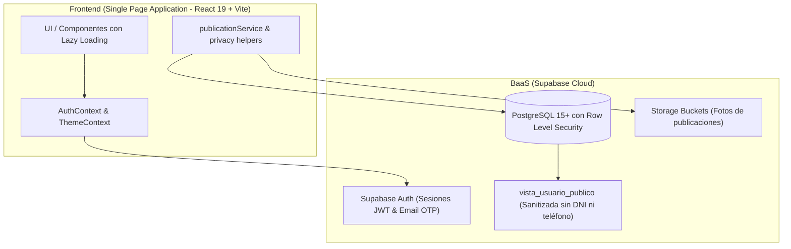

# Truekly — Plataforma Web de Trueque Comunitario y Economía Circular

Plataforma comunitaria de intercambio de bienes de valor equivalente orientada a Chimbote y el mercado peruano. Diseñada para fomentar el consumo circular, la confianza vecinal mediante puntos de encuentro seguros y la protección de datos personales de acuerdo con la **Ley N° 29733**.

---

## Arquitectura del Sistema



---

## Decisiones Clave de Arquitectura (ADRs)

### ADR-001: Economía de trueque directo sin dinero fiduciario
- **Contexto**: Las plataformas tradicionales de compraventa (Marketplace, Mercado Libre) exponen a los usuarios a estafas de transferencias falsas, comisiones elevadas y regateo desmedido.
- **Decisión**: Truekly elimina el dinero fiduciario. Cada publicación define qué busca a cambio (`wantsInReturn`), y los acuerdos se cierran mediante equivalencia de valor y puntos de encuentro vecinales.

### ADR-002: Privacidad y mitigación de doxxing (Censura estilo Yape)
- **Contexto**: Exigir DNI/RENIEC para verificar identidad es indispensable para evitar fraudes, pero exponer nombres legales completos y geolocalización GPS exacta facilita el acoso, secuestro al paso o extorsión.
- **Decisión**: Los nombres legales solo se validan en backend. En interfaz pública se utiliza censura tipo billetera digital (`Ladi Jose Vi*** Co***`) y la geolocalización se restringe a zonas referenciales (ej. *Chimbote Centro*, *Nuevo Chimbote*), sin telemetría GPS continua.

### ADR-003: Principio de mínimo privilegio con Row Level Security (RLS)
- **Contexto**: Un BaaS expone una anon key en frontend, lo que convierte a la base de datos en el perímetro defensivo principal contra scraping.
- **Decisión**: La tabla `public.usuario` tiene políticas RLS estrictas que solo permiten lectura al propio usuario autenticado (`auth.uid() = id`). Los datos públicos se consumen exclusivamente a través de la vista sanitizada `public.vista_usuario_publico`. Las publicaciones solo pueden ser modificadas o eliminadas por su creador verificado.

### ADR-004: Code Splitting por ruta y suite de testing nativa con Node 24
- **Contexto**: Una SPA con múltiples flujos (registro multi-paso, feed con subastas, detalle de producto) puede convertirse en un bundle monolítico lento para redes móviles 3G/4G.
- **Decisión**: Se implementa `React.lazy()` y `Suspense` en las rutas principales, reduciendo el tamaño del chunk inicial en más del 65%. Las pruebas unitarias se ejecutan mediante el runner nativo de Node 24 (`node:test`), eliminando dependencias pesadas de terceros.

### ADR-005: Handshake Transaccional ACID en PostgreSQL (Pessimistic Concurrency)
- **Contexto**: En un sistema de trueque sin dinero, pueden ocurrir condiciones de carrera donde un usuario intenta intercambiar el mismo artículo con dos personas diferentes a la vez, o una parte se retira a mitad del acuerdo.
- **Decisión**: Se implementa la función RPC `confirmar_handshake_trueque` en PostgreSQL con bloqueo pesimista a nivel de fila (`SELECT FOR UPDATE`). Requiere doble confirmación autenticada. Al completarse, actualiza ambas publicaciones a estado `intercambiado` y cancela automáticamente en la misma transacción atómica cualquier propuesta concurrente de los mismos artículos, garantizando consistencia ACID.

---

## Stack Tecnológico

- **Frontend**: React 19, TypeScript, Vite, Tailwind CSS v4, Lucide Icons.
- **Enrutamiento y Estado**: React Router 7, React Context API.
- **Backend & Persistencia**: Supabase (PostgreSQL con RLS, Supabase Auth, Supabase Storage).
- **Calidad & Testing**: Oxlint, TypeScript compiler (`tsc -b`), Node.js 24 Test Runner (`node:test`).
- **CI/CD**: GitHub Actions (Lint, Typecheck, Unit Tests y Production Build en cada Push/PR).

---

## Ejecución Local y Testing

### 1. Clonar e instalar dependencias
```bash
git clone https://github.com/josevillanueva/truekly-aplicativoWeb.git
cd truekly-aplicativoWeb
npm install
```

### 2. Configurar variables de entorno
Crea un archivo `.env` en la raíz del proyecto:
```env
VITE_SUPABASE_URL=https://tu-proyecto.supabase.co
VITE_SUPABASE_ANON_KEY=tu-anon-key-publica
```

### 3. Ejecutar suite de pruebas unitarias
```bash
npm test
```

### 4. Verificar linter y build de producción
```bash
npm run lint
npm run build
```

### 5. Levantar servidor local de desarrollo
```bash
npm run dev
```
