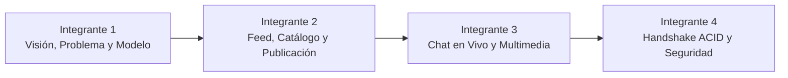

# Truekly — Guía Maestra de Sustentación y Arquitectura del Proyecto

> **Documento oficial para exposición final y transferencia técnica.**  
> Este dossier contiene la visión de negocio, arquitectura de software, detalle técnico de cada módulo, flujo de demostración en vivo y guion dividido por expositores.

---

## 1. Ficha Técnica y Propuesta de Valor

### ¿Qué es Truekly?
**Truekly** es una plataforma web C2C (Consumer-to-Consumer) de **trueque e intercambio de bienes de segunda mano**, enfocada en economía circular, seguridad física y construcción de confianza comunitaria.

### El Problema que Resuelve
En América Latina y Perú, el trueque informal ocurre en grupos caóticos de Facebook Marketplace o WhatsApp:
1. **Desconfianza y estafas:** Cuentas falsas, perfiles sin verificar, cancelaciones de última hora.
2. **Inseguridad física:** Citas en lugares peligrosos o desconocidos.
3. **Falta de trazabilidad:** No hay registro formal de lo acordado ni reputación verificable.
4. **Barrera de liquidez:** Muchas personas poseen artículos en buen estado pero no dinero en efectivo.

### La Solución de Truekly
- **Trueque Libre (Sin dinero ni tasaciones rígidas):** Intercambio directo objeto por objeto según mutuo acuerdo.
- **Identidad Verificada:** Verificación de DNI y selfie con protección de datos personales.
- **Puntos de Encuentro Seguros:** Recomendación de zonas públicas monitoreadas (comisarías, centros comerciales, plazas bancarias).
- **Handshake Transaccional ACID en 2 Fases:** Pacto formal mutuo previo + Confirmación física presencial (1/2 y 2/2).
- **Eficiencia de Costos (100% Free-Tier):** Arquitectura optimizada para operar con costo cero en infraestructura gratuita (Vercel + Supabase Free).

---

## 2. Stack Tecnológico y Arquitectura

```
┌────────────────────────────────────────────────────────┐
│                   CLIENTE (Frontend)                   │
│  React 18 + TypeScript (Strict) + Vite + Tailwind CSS  │
│  • Compresión de imagen/video en canvas (Client-side)  │
│  • Enrutamiento por hash/vistas protegidas             │
│  • Estado reactivo con Context API                     │
└──────────────────────────┬─────────────────────────────┘
                           │ HTTPS / WebSocket (WSS)
┌──────────────────────────▼─────────────────────────────┐
│                 BACKEND AS A SERVICE (Supabase)        │
│  • PostgreSQL 17 (Relacional ACID + RLS)               │
│  • Supabase Auth (JWT cifrado + sesiones seguras)      │
│  • Supabase Realtime (Canales WebSocket bidireccionales│
│  • Supabase Storage (Buckets públicos y privados)      │
│  • Procedimientos Almacenados PL/pgSQL (Handshake)     │
└────────────────────────────────────────────────────────┘
```

- **Frontend:** React 18, TypeScript en modo estricto, Vite, Tailwind CSS, Lucide Icons. Cero tipografías monospace de cliché; se utiliza `Plus Jakarta Sans` en toda la interfaz.
- **Base de Datos & BaaS:** Supabase PostgreSQL con Row Level Security (RLS) activo en el 100% de las tablas, Supabase Auth con JWT seguro, Supabase Realtime para mensajería instantánea.
- **Despliegue & Hosting:** Vercel (Frontend CI/CD automatizado conectado a GitHub).

---

## 3. Desglose Módulo por Módulo (Para la Exposición)

### Módulo 1: Landing Page y Filosofía Visual
- **Objetivo:** Explicar el propósito del proyecto en menos de 5 segundos.
- **Puntos clave a exponer:**
  - Estética *editorial cálida* con paleta oficial: Verde Jade (`#0F6D5F` para confianza y acciones principales), Ámbar (`#E8A33D` para alertas y transacciones) y Papel (`#F7F8F6`).
  - Fotografía real de intercambio presencial humano en lugar de ilustraciones genéricas de IA.
  - Soporte completo de Modo Claro y Modo Oscuro accesible mediante botón persistente.
  - Acceso libre al catálogo para visitantes sin forzar registro previo.

### Módulo 2: Feed de Exploración y Búsqueda C2C
- **Objetivo:** Descubrir artículos disponibles en la ciudad piloto (Chimbote) o zonas aledañas.
- **Puntos clave a exponer:**
  - Tarjetas visuales de producto con proporción natural de fotografía.
  - Filtros combinables en tiempo real: categoría obligatoria, estado del producto (*Nuevo*, *Como nuevo*, *Buen estado*, *Usado*) y zona/distrito.
  - Búsqueda aproximada respetando privacidad: no se rastrea la ubicación exacta por GPS para evitar exponer domicilios de usuarios; se utilizan zonas urbanas referenciales.

### Módulo 3: Publicación de Artículos y Optimización Client-Side
- **Objetivo:** Publicar un objeto en menos de 2 minutos sin saturar almacenamiento.
- **Puntos clave a exponer:**
  - **Wizard guiado en 3 pasos:** Datos básicos, selección de fotos y zona/punto seguro recomendado.
  - **Compresión de imágenes en el navegador:** Un canvas HTML5 reduce fotos pesadas a JPEG optimizado (máx. 1200px) antes del envío, permitiendo que la plataforma viva holgadamente dentro de la cuota gratuita de 1 GB de Supabase Storage.
  - **Bloqueo transaccional anti-estafas:** Cuando un artículo entra en negociación activa en chats, el campo de estado queda bloqueado para que el vendedor no altere las condiciones de última hora.

### Módulo 4: Chat en Tiempo Real y Mensajería Multimedia
- **Objetivo:** Negociar y acordar los términos del intercambio en un canal seguro.
- **Puntos clave a exponer:**
  - **Interfaz de pantalla completa:** Panel izquierdo con lista de conversaciones agrupadas por artículo y panel derecho con ventana conversacional fluida.
  - **Checks de entrega estilo mensajería moderna:** Un check para mensaje enviado, doble check gris para entregado al destinatario, doble check celeste/azul cuando el destinatario lo lee.
  - **Envío de evidencia multimedia (Fotos y Videos):** Los usuarios pueden adjuntar fotos de su producto ofertado o videos cortos directamente en el chat para demostrar su estado físico real.
  - **Sincronización WebSocket (Supabase Realtime):** Los mensajes, archivos y cambios de estado aparecen instantáneamente entre ventanas sin recargar la página.

### Módulo 5: Pacto Formal y Handshake Transaccional ACID (La Joya Técnica)
- **Objetivo:** Formalizar legal y operativamente el trueque para evitar estafas y cancelaciones.
- **El flujo se divide en 3 Fases:**
  1. **Fase 1 — Propuesta Exclusiva del Dueño:** Solo el creador de la publicación puede presionar **"Pactar Trueque"**, indicando qué artículo acepta a cambio y en qué punto seguro se encontrarán. Al proponente le sale *"Esperando respuesta de la contraparte"*.
  2. **Fase 2 — Aceptación Formal del Pacto:** A la contraparte le aparecen de inmediato los botones **"Aceptar Pacto"** y **"Rechazar"** (tanto en el banner superior como en la burbuja del chat). Al aceptar, en **ambas pantallas** desaparece la espera y el estado pasa a **"✅ Pacto formal acordado — Coordinar entrega presencial"**.
  3. **Fase 3 — Handshake Presencial (Entrega Física):** Se encuentran en el punto seguro (ej. MegaPlaza Chimbote). Cada usuario presiona **"Confirmar entrega presencial"** con el objeto en mano. Con la primera confirmación el sistema marca (1/2); con la segunda confirmación (2/2) la base de datos ejecuta el cierre ACID:
     - La propuesta pasa a `completada`.
     - La publicación pasa automáticamente a `intercambiado`.
     - Todos los demás chats abiertos sobre ese mismo artículo se cancelan automáticamente para evitar doble trueque.

### Módulo 6: Perfil Seguro y Criterio Legal Preventivo
- **Objetivo:** Garantizar la seguridad de las personas y cumplir la Ley de Protección de Datos Personales (Ley 29733).
- **Puntos clave a exponer:**
  - Nombres públicos protegidos con censura estilo billeteras digitales (apellidos paternos y maternos ofuscados: *Valeria R\*\*\*\**).
  - Correo electrónico ofuscado (*v\*\*\*\*@gmail.com*).
  - Documentos de identidad (DNI y selfie) almacenados en buckets privados bajo Row Level Security; ningún usuario ajeno puede inspeccionar documentos privados.

---

## 4. Guion de Exposición Sugerido (Equipo de 3 o 4 Integrantes)



### Integrante 1: Problema, Oportunidad y Arquitectura General (2 - 3 min)
- **Apertura:** Saludo al jurado. "Hoy presentamos **Truekly**, la plataforma web de trueque seguro y economía circular diseñada para resolver la desconfianza del comercio entre personas".
- **Problema:** Explicar cómo los grupos de Facebook y WhatsApp están llenos de cuentas falsas, riesgos en la calle y nula garantía.
- **Diferencial:** Truekly no utiliza dinero ficticio ni tasaciones arbitrarias; promueve el trueque libre respaldado por puntos seguros y perfiles verificados.
- **Stack Técnico:** Mención limpia de React 18, TypeScript, Supabase PostgreSQL y despliegue en Vercel, optimizado para operar sin costos de servidor.

### Integrante 2: Exploración, Filtros y Creación de Publicaciones (2 - 3 min)
- **Demostración en vivo:** Mostrar el Feed principal en el navegador.
- **Filtros:** Demostrar cómo se filtra por categoría (Tecnología, Ropa, Herramientas, etc.) y por estado de conservación.
- **Privacidad de Zona:** Destacar que se usan distritos y zonas públicas, protegiendo la dirección domiciliaria del usuario.
- **Publicación de Trueque:** Abrir el modal de publicación, mostrar cómo se adjuntan fotos y explicar que la compresión se realiza en el cliente en milisegundos para optimizar el almacenamiento gratuito de la base de datos.

### Integrante 3: Negociación, Chat en Tiempo Real y Envío Multimedia (2 - 3 min)
- **Demostración con 2 navegadores/cuentas:** Abrir dos ventanas (una normal y una en incógnito) con los usuarios de prueba.
- **Canal de Chat:** Mostrar el envío de mensajes instantáneos sin recarga mediante WebSockets (Supabase Realtime).
- **Checks estilo WhatsApp:** Señalar cómo los checks cambian de enviado a leído cuando la otra persona abre el chat.
- **Multimedia:** Enviar una foto o video en vivo del producto que se ofrece a cambio; abrir el visualizador modal para que el jurado aprecie la resolución y fluidez.

### Integrante 4: Pacto Formal, Handshake ACID y Cierre Transaccional (3 min)
- **Demostración del Pacto:** Desde la cuenta del dueño de la publicación, pulsar **"Pactar Trueque"** y definir el punto de encuentro seguro (ej. MegaPlaza Chimbote).
- **Aceptación Mutua:** Mostrar cómo en la segunda ventana aparece al instante el botón **"Aceptar Pacto"** en el banner y en la conversación. Al hacer clic, ambas pantallas pasan a estado coordinado.
- **Confirmación Presencial:** Realizar la confirmación física (1/2 y luego 2/2). Mostrar el mensaje de éxito y verificar en el feed que la publicación ya no está disponible porque el trueque concluyó satisfactoriamente.
- **Cierre y Seguridad:** Explicar el bloqueo pesimista contra doble trueque y la privacidad de datos (DNI cifrado, nombres enmascarados).

---

## 5. Preguntas Difíciles del Jurado (y Cómo Responderlas)

| Pregunta del Jurado | Respuesta Técnica y de Negocio |
|---|---|
| **¿Por qué no le asignan un precio o tasación a los productos?** | Porque el valor de un bien usado es subjetivo: lo que para uno es un objeto sin uso en un cajón, para otro es una herramienta necesaria de trabajo. Los modelos con tasación fija fracasan por disputas de precio. Truekly adopta el modelo de **trueque libre con consentimiento informado**, donde el valor lo valida el acuerdo mutuo de las partes en el chat. |
| **¿Cómo evitan que una persona sufra un robo o estafa en el encuentro físico?** | Mediante 3 capas de defensa: 1) Verificación de identidad con DNI y selfie; 2) **Puntos Seguros Recomendados** (centros comerciales, estaciones o plazas con vigilancia y cámaras de seguridad); 3) **Handshake Transaccional**, donde la entrega se confirma únicamente cuando ambas partes tienen el objeto en mano. |
| **¿Qué pasa si dos personas intentan aceptar el mismo artículo al mismo tiempo?** | La base de datos PostgreSQL ejecuta una transacción ACID mediante la función `confirmar_handshake_trueque`. Utiliza un bloqueo pesimista (`SELECT FOR UPDATE`). En cuanto una propuesta alcanza la doble confirmación, un trigger/update cancela automáticamente todas las demás propuestas pendientes sobre esa misma publicación y la retira del feed. |
| **¿Cómo se mantiene económicamente este proyecto si es gratuito?** | La infraestructura está optimizada al 100% para el Free-Tier (compresión canvas en el cliente, consultas ligeras por índices en PostgreSQL, hosting estático en Vercel). A futuro, el modelo contempla cuentas comerciales verificadas para negocios locales y subastas comunitarias destacadas. |
| **¿Cumplen con la normativa de privacidad peruana (Ley 29733)?** | Sí. Aplicamos el principio de minimización de datos: no recolectamos geolocalización exacta por GPS, los DNI y selfies se guardan en un bucket privado protegido por Row Level Security (inaccesible al público), y los nombres mostrados en pantalla se ofuscan para prevenir acoso o ingeniería social. |

---

## 6. Cuentas de Prueba Listas para la Demostración

- **Usuario Publicador:** `valeria.truekly@gmail.com` (o `@mateo_trueques`)
- **Usuario Contraparte:** `contraparte.truekly@gmail.com`
- **Punto Seguro Recomendado de Demostración:** *MegaPlaza Chimbote (Zona Bancaria)* o *Plaza de Armas de Chimbote*.
